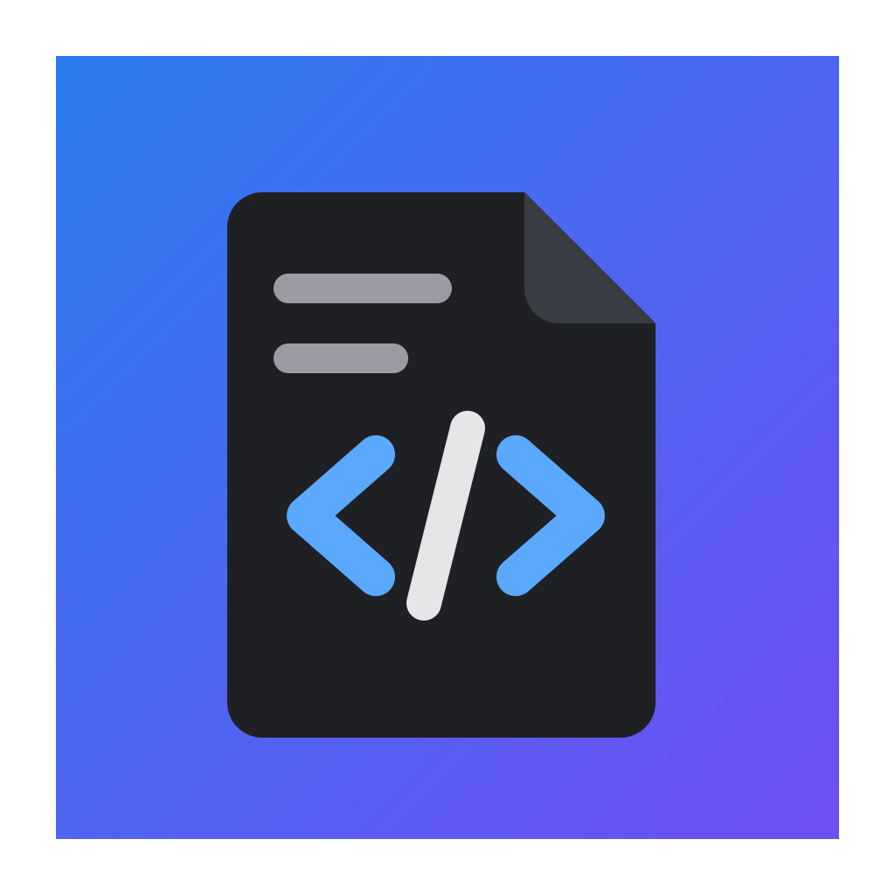

<p align="center">
  
</p>

<h1 align="center">HTML Note</h1>

<p align="center">
  Редактор документов в стиле Google Документов, который сохраняет результат в <b>один HTML-файл</b>.<br>
  <i>A Google Docs–style editor that saves your document as a single self-contained HTML file.</i>
</p>

<p align="center">
  <a href="https://github.com/Ovolsan/HTML-Note/releases/latest"><b>⬇ Скачать для Windows</b></a> ·
  <a href="https://raw.githack.com/Ovolsan/HTML-Note/main/%D0%94%D0%B5%D0%BC%D0%BE%D0%BD%D1%81%D1%82%D1%80%D0%B0%D1%86%D0%B8%D1%8F.html"><b>👀 Открыть демонстрацию</b></a> ·
  <a href="LICENSE">GPL-3.0</a>
</p>

---

## Зачем

Хочется написать красивую заметку, гайд или пост — с картинками, видео, спойлерами и кнопками, — и отдать её человеку **одним файлом**. Без облака, без аккаунтов, без «откройте в такой-то программе».

HTML Note делает именно это: вы пишете как в Google Документах, а на выходе получаете обычный `.html`. Его можно отправить в Telegram или Discord, положить на флешку, выложить на любой хостинг — он откроется в любом браузере на компьютере и телефоне. Всё внутри: картинки, видео, стили и небольшой скрипт для просмотра.

## Демонстрация

Файл [`Демонстрация.html`](Демонстрация.html) сделан в HTML Note и показывает почти всё, что умеет редактор: содержание, спойлер, списки, цитату с картинкой, кнопки-ссылки, блок кода, таблицу с объединёнными ячейками, встроенное видео и просмотр картинок на весь экран.

👉 **[Открыть демонстрацию в браузере](https://raw.githack.com/Ovolsan/HTML-Note/main/%D0%94%D0%B5%D0%BC%D0%BE%D0%BD%D1%81%D1%82%D1%80%D0%B0%D1%86%D0%B8%D1%8F.html)** (файл большой, около 6,5 МБ — в нём встроено видео; если не открылось, скачайте его из [релиза](https://github.com/Ovolsan/HTML-Note/releases/latest) и откройте двойным щелчком).

## Возможности

**Текст**
- Стиль абзаца, шрифт и размер для выделенного текста.
- Жирный, курсив, подчёркнутый, зачёркнутый, цвет текста и цвет выделения, очистка форматирования.
- Ссылки, выравнивание (влево, по центру, вправо, по ширине).
- Списки: нумерованный, маркированный, список задач с галочками.
- Цитаты, блоки кода, горизонтальные линии.
- Эмодзи, в том числе свои собственные.

**Картинки и видео**
- Вставка кнопкой, через Ctrl+V или перетаскиванием.
- Ширина 25–100 %, выравнивание, подпись.
- В сохранённом файле картинка открывается на весь экран по щелчку, между картинками можно листать.
- Видео с компьютера (встраивается прямо в документ) или прямая ссылка на `.mp4`. Ссылка на YouTube или Vimeo вставляется обычной ссылкой: встроенный плеер этих сайтов не играет в файле, открытом с диска.

**Блоки**
- Кнопки-ссылки (заливка или контур).
- Спойлеры — сворачиваемые блоки.
- Таблицы: строки и столбцы, строка заголовков, объединение и разделение ячеек.
- Содержание документа — включается одной кнопкой и сохраняется в файл.

**Интерфейс**
- Тёмная тема, лист без засечек, настраиваемая ширина листа.
- Панели настраиваются: кнопки можно перетаскивать на верхнюю, нижнюю и правую панели, панели сворачиваются.
- Кнопка «Открыть в браузере» — посмотреть, как документ увидит читатель.
- Своя рамка окна в цвет интерфейса; окно запоминает размер и положение.
- Проверка обновлений: при запуске (не чаще раза в сутки) и кнопкой «Обновления». Если на GitHub вышла новая версия, программа предложит скачать установщик.

**Безопасность ваших файлов**
- Чужой HTML открывается для правки, но **никогда не перезаписывается**: «Сохранить» создаёт новый файл.
- Программа может стать редактором для `.html` / `.htm` в Windows.

## Горячие клавиши

| Действие | Клавиши |
|---|---|
| Новый / Открыть / Сохранить | Ctrl+N / Ctrl+O / Ctrl+S |
| Сохранить как | Ctrl+Shift+S |
| Жирный / Курсив / Подчёркнутый | Ctrl+B / Ctrl+I / Ctrl+U |
| Зачёркнутый | Alt+Shift+5 |
| Ссылка | Ctrl+K |
| Отменить / Повторить | Ctrl+Z / Ctrl+Y |

## Установка

Скачайте установщик `…_x64-setup.exe` со страницы [релизов](https://github.com/Ovolsan/HTML-Note/releases/latest) и запустите. Установка идёт в профиль пользователя, права администратора не нужны. Нужна Windows 10/11 (WebView2 уже есть в системе).

## Разработка

Нужны Node.js 22, Rust (stable, MSVC) и инструменты сборки Microsoft C++. Rust и инструменты ставит `tools\install-rust.cmd` (запускать двойным щелчком из Проводника).

```bat
npm install
npm run dev          :: редактор в браузере, http://localhost:1420
npm run tauri dev    :: программа в окне
npm run tauri build  :: установщик в src-tauri\target\release\bundle\nsis
```

Для сборки можно просто запустить `tools\build.cmd`.

Версия — дата выпуска: `2026.10.28` в `package.json`, `src-tauri/tauri.conf.json` и `src-tauri/Cargo.toml`. Выпуск на GitHub помечается той же датой без точек (`20261028`): по этой метке программа узнаёт о новой версии.

### Устройство

- `src/` — интерфейс на JavaScript: редактор [TipTap](https://tiptap.dev/) (ProseMirror), панели, сохранение в HTML (`document.js`).
- `src/styles/doc.css` — оформление документа; одно и то же в редакторе и в сохранённом файле.
- `src/export/` — оформление страницы и небольшой скрипт сохранённого файла (просмотр картинок, подсветка содержания).
- `src-tauri/` — часть на Rust ([Tauri 2](https://tauri.app/)): окно, чтение и запись файлов, открытие в браузере.

## Лицензия

HTML Note распространяется по лицензии **GNU General Public License v3.0** — см. файл [LICENSE](LICENSE).

Вы можете свободно использовать, изучать, изменять и распространять программу. Если вы распространяете изменённую версию, она тоже должна выходить под GPL-3.0 с открытым исходным кодом.

## Автор

Ovolsan · [Telegram-канал](https://t.me/ovolpost) · [Discord](https://discord.gg/TNevady)

---

<sub>
<b>Keywords:</b> html editor, wysiwyg editor, single file html, self-contained html, offline document editor, google docs alternative, notes app, rich text editor, html notes, document to html, tiptap, prosemirror, tauri, rust, javascript, windows, desktop app, spoilers, image gallery, embedded video, table of contents, telegram post, discord guide, open source, gpl-3.0
<br>
<b>Ключевые слова:</b> редактор html, визуальный редактор, wysiwyg редактор, html в одном файле, автономный html, офлайн редактор документов, аналог google документов, альтернатива google docs, заметки, редактор заметок, текстовый редактор, html заметки, гайд в одном файле, спойлеры, галерея картинок, встроенное видео, содержание документа, пост для телеграма, гайд для дискорда, программа для windows, открытый исходный код, свободное по
</sub>
